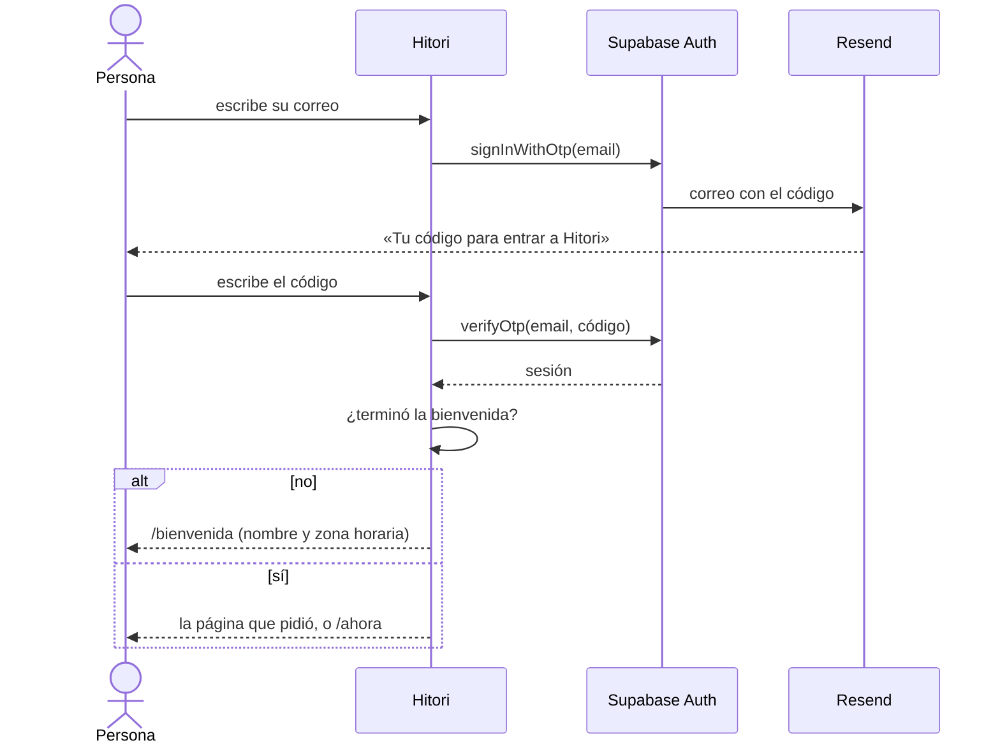

# Inicio de sesión

Hitori no usa contraseñas. Hay dos formas de entrar:

1. **Código por correo:** la persona escribe su correo, recibe un código de 6 dígitos (vence en 10 minutos) y lo escribe en la app. Es `signInWithOtp` + `verifyOtp` de Supabase Auth.
2. **Google:** OAuth con permisos básicos (`openid`, `email`, `profile`), que no requieren que Google revise la app. **Queda fuera del MVP:** el botón se ve, pero abre el aviso «Muy pronto». Se enciende con `VITE_GOOGLE_SIGN_IN=true` en `.env.production` cuando el cliente OAuth esté configurado.

## Rutas

- `/entrar` es pública. Si ya hay sesión, manda a la página pedida.
- Todo lo demás exige sesión. Sin sesión se va a `/entrar?redirect=<ruta>` y, al entrar, vuelve a esa ruta (solo rutas internas).
- Con sesión pero sin terminar la bienvenida, todo manda a `/bienvenida`.
- Al cerrar sesión (aquí o en otra pestaña) se limpia la caché y se vuelve a `/entrar`.

## Local

Supabase local manda los correos a su buzón de prueba: <http://127.0.0.1:55324>. La plantilla está en `supabase/templates/sign-in-code.html` y se configura en `supabase/config.toml`.

## Producción (panel de Supabase, proyecto `hitori`)

| Dónde                                   | Qué                                                                                                                                              |
| --------------------------------------- | ------------------------------------------------------------------------------------------------------------------------------------------------ |
| Authentication → URL Configuration      | Site URL `https://hitori.escudevwork.com`; Redirect URLs `https://hitori.escudevwork.com/**` y `https://*-hitori.estebancarcamou.workers.dev/**` |
| Authentication → Emails → SMTP Settings | Resend: `smtp.resend.com`, puerto `465`, usuario `resend`, remitente `Hitori <no-reply@escudevwork.com>`                                         |
| Authentication → Emails → Templates     | «Confirm signup» y «Magic Link» con el asunto y el HTML de `supabase/templates/sign-in-code.html`                                                |
| Authentication → Providers → Email      | Email OTP de 6 dígitos y 600 segundos de vigencia                                                                                                |
| Authentication → Providers → Google     | Pendiente (fuera del MVP): Client ID y secret del cliente OAuth de Google Cloud                                                                  |
