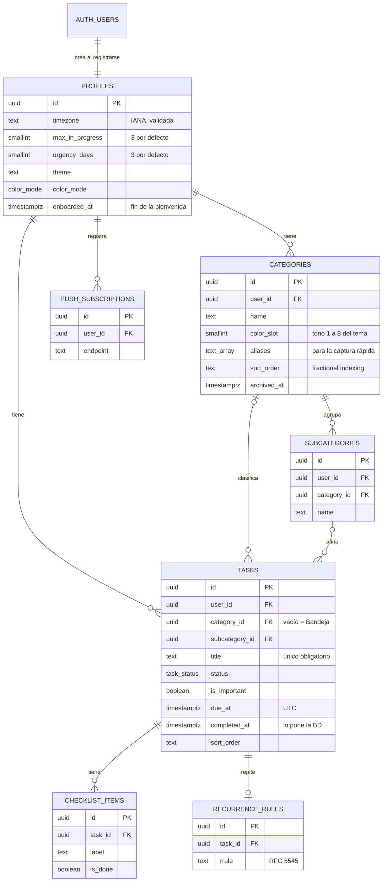

# Base de datos

PostgreSQL en Supabase. El esquema vive en `supabase/migrations/` y es la única fuente de verdad: nunca se cambia a mano en el panel.

## Modelo

## Reglas que garantiza la base de datos

- **Cada quien ve solo lo suyo.** Todas las tablas tienen RLS con `user_id = auth.uid()`. Los visitantes sin sesión (`anon`) no tienen ningún permiso.
- **Nadie apunta a datos ajenos.** Las llaves foráneas son compuestas con `user_id`: una tarea no puede usar la categoría de otro usuario aunque conozca su id.
- **La subcategoría pertenece a la categoría de la tarea** (llave foránea `subcategory_id, category_id`).
- **Borrar una categoría no borra tareas:** quedan sin categoría y vuelven a la Bandeja.
- **`completed_at` lo pone la BD** al pasar a `done`, no se puede reescribir mientras siga hecha y se limpia al salir de `done`.
- **Zona horaria válida:** el perfil solo acepta zonas IANA (`America/Guatemala`).
- **El perfil se crea solo** al registrarse, con el nombre que traiga la cuenta.

La urgencia, el cuadrante, los días de atraso y «lista para hacer» **no se guardan**: dependen de la hora actual y se calculan en `domain/`.

## Trabajar en local

Supabase local usa puertos propios (553xx) para convivir con otros proyectos.

| Comando            | Qué hace                                                          |
| ------------------ | ----------------------------------------------------------------- |
| `npm run db:start` | Levanta Postgres en Docker y aplica migraciones                   |
| `npm run db:reset` | Recrea la BD desde cero con las migraciones y `supabase/seed.sql` |
| `npm run db:test`  | Corre las pruebas pgTAP de `supabase/tests/database/`             |
| `npm run db:lint`  | Revisa las funciones SQL                                          |
| `npm run db:types` | Regenera `src/shared/lib/database.types.ts`                       |

El seed crea el usuario `dev@hitori.test` con las categorías U, Trabajo, Internship y Personal y una docena de tareas.

Para un cambio de esquema: `supabase migration new <nombre>`, escribir el SQL, `npm run db:reset`, agregar o ajustar pruebas, `npm run db:test` y `npm run db:types`.

## Producción

Proyecto `hitori` en `us-east-1` (plan gratis). Al hacer merge a `main` de un cambio en `supabase/migrations/`, el workflow **Deploy database** corre `supabase db push`. Necesita:

- Variable del repo `SUPABASE_PROJECT_REF`.
- Secretos del repo `SUPABASE_ACCESS_TOKEN` y `SUPABASE_DB_PASSWORD`.

El seed nunca se aplica en producción.
